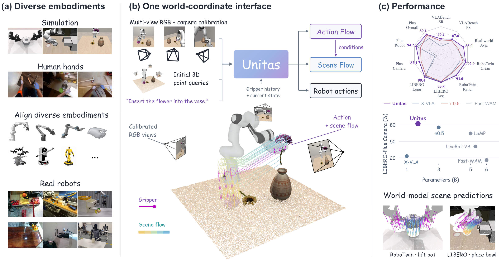
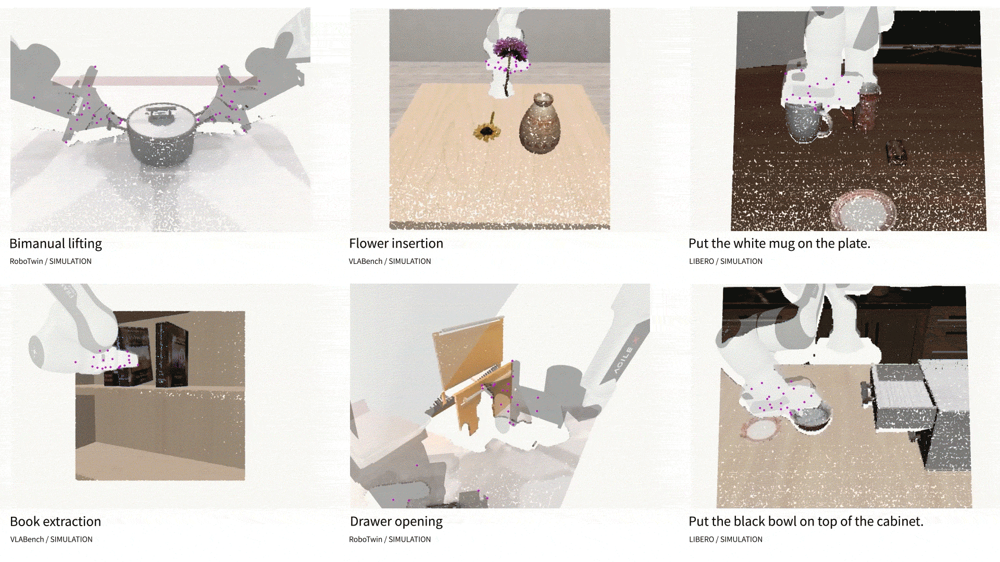

<div align="center">

<h1>Unitas: A 3D-Native World Action Model for Embodied Manipulation</h1>

<p>
  <a href="https://dexforce.com/technical-report/#/unitas-wam"></a>
  <a href="https://arxiv.org/abs/2610.12099"></a>
  <a href="https://huggingface.co/RobbinWang123/Unitas"></a>
  
  <a href="LICENSE"></a>
</p>

<p>
<span><a href="https://robbinw.github.io/" rel="noopener noreferrer" target="_blank">Ruixiang Wang</a><sup>1,2*</sup></span>, &nbsp; <span><a href="https://yysu.site/" rel="noopener noreferrer" target="_blank">Yongyi Su</a><sup>3*†</sup></span>, &nbsp; <span>Wenlve Zhou<sup>3</sup></span>, &nbsp; <span>Bo Yue<sup>1,2</sup></span>, &nbsp; <span>Hengyan Liu<sup>1,2</sup></span>, &nbsp; <span>Dekun Lu<sup>2</sup></span><br>
<span>Yuxin Tian<sup>1,2</sup></span>, &nbsp; <span>Yihan Fang<sup>1,2</sup></span>, &nbsp; <span>Zerui Wu<sup>2</sup></span>, &nbsp; <span>Xing Hu<sup>2</sup></span>, &nbsp; <span>Jietao Chen<sup>2</sup></span>, &nbsp; <span>Yong Guo<sup>2</sup></span><br>
<span>Ziyan He<sup>2</sup></span>, &nbsp; <span>Junbin Yuan<sup>4</sup></span>, &nbsp; <span>Guiliang Liu<sup>1</sup></span>, &nbsp; <span>Xiaofen Xing<sup>5</sup></span>, &nbsp; <span><a href="http://kuijia.site/" rel="noopener noreferrer" target="_blank">Kui Jia</a><sup>1,2</sup></span>
<br>
<sub>
<sup>1</sup> CUHK-SZ &nbsp; <sup>2</sup> DexForce &nbsp; <sup>3</sup> FSU &nbsp; <sup>4</sup> SYSU &nbsp; <sup>5</sup> SCUT &nbsp; · &nbsp;
<sup>*</sup> Equal contribution &nbsp; <sup>†</sup> Correspondence to &lt;suyongyi@fosu.edu.cn&gt;
</sub>
</p>

</div>



**UNITAS** is a 3D-native world action model for embodied manipulation. It unifies observations, actions, and scene dynamics in a shared metric 3D frame within each interaction, using a common representation across robot embodiments and human hands.

### Highlights

- **One physical space.** Observations, actions, and scene dynamics share a metric 3D world-coordinate frame.
- **A common motion representation.** Point trajectories represent robot motion, human hand motion, and scene dynamics.
- **Complementary capabilities.** The framework supports robot-action generation and action-conditioned scene prediction.
- **Paper results with 1.7B parameters.** Success rates reach **99.8%** on LIBERO, **89.1%** on LIBERO-Plus, **56.2%** on VLABench, and **92.94% / 93.04%** on RoboTwin Clean / Randomized. Moving ADE is **35% lower** than PointWorld on RoboTwin scene prediction.

## Release status

- [x] Model checkpoints
- [x] Inference and evaluation code
- [ ] Training code
- [ ] Training dataset

## Installation

Clone this repo and set up the environment with a few commands:

```bash
git clone https://github.com/DexForce/UNITAS.git
cd UNITAS

conda create -n unitas python=3.10 pip -y
conda activate unitas
python -m pip install -e .
```

Optional FlashAttention 2 (requires a compatible CUDA toolkit):

```bash
python -m pip install "flash-attn>=2.6,<3" --no-build-isolation
```

Florence uses FlashAttention 2 when available, otherwise PyTorch SDPA.

Download [Florence-2-large](http://huggingface.co/microsoft/Florence-2-large)
to `checkpoints/Florence-2-large`; all UNITAS checkpoints share this encoder:

```bash
python -m pip install "huggingface_hub[cli]>=0.34,<1"
hf download microsoft/Florence-2-large \
  --local-dir checkpoints/Florence-2-large \
  --exclude "*.bin"
```

## Model checkpoints

Download the checkpoints you need to `checkpoints/`.

<table>
  <thead>
    <tr>
      <th>Model</th>
      <th>Use case</th>
      <th>From scratch</th>
      <th>Pretrained → Fine-tuned</th>
    </tr>
  </thead>
  <tbody>
    <tr>
      <td><a href="https://huggingface.co/RobbinWang123/Unitas#robotwin"><strong>UNITAS-RoboTwin</strong></a></td>
      <td>RoboTwin Clean / Randomized evaluation</td>
      <td><a href="https://huggingface.co/RobbinWang123/Unitas/blob/main/unitas_robotwin_scratch.pt">Checkpoint</a></td>
      <td><a href="https://huggingface.co/RobbinWang123/Unitas/blob/main/unitas_robotwin_finetuned.pt">Checkpoint</a></td>
    </tr>
    <tr>
      <td><a href="https://huggingface.co/RobbinWang123/Unitas#libero"><strong>UNITAS-LIBERO</strong></a></td>
      <td>LIBERO / LIBERO-Plus evaluation</td>
      <td><a href="https://huggingface.co/RobbinWang123/Unitas/blob/main/unitas_libero_scratch.pt">Checkpoint</a></td>
      <td><a href="https://huggingface.co/RobbinWang123/Unitas/blob/main/unitas_libero_finetuned.pt">Checkpoint</a></td>
    </tr>
    <tr>
      <td><a href="https://huggingface.co/RobbinWang123/Unitas#vlabench"><strong>UNITAS-VLABench</strong></a></td>
      <td>VLABench evaluation</td>
      <td><a href="https://huggingface.co/RobbinWang123/Unitas/blob/main/unitas_vlabench_scratch.pt">Checkpoint</a></td>
      <td><a href="https://huggingface.co/RobbinWang123/Unitas/blob/main/unitas_vlabench_finetuned.pt">Checkpoint</a></td>
    </tr>
    <tr>
      <td><a href="https://huggingface.co/RobbinWang123/Unitas#scene-flow"><strong>UNITAS-SceneFlow</strong></a></td>
      <td>Action and scene flow prediction</td>
      <td colspan="2" align="center"><a href="https://huggingface.co/RobbinWang123/Unitas/blob/main/unitas_scene_flow.pt">Jointly trained</a></td>
    </tr>
  </tbody>
</table>

## Scene flow



Run from the repository root after installation. The bundled RGB-D sample needs no simulator.
[inference.py](src/unitas/scene_flow/inference.py) saves predicted scene and gripper
trajectories; [visualize.py](src/unitas/scene_flow/visualize.py) opens the saved result in Viser.

```bash
python src/unitas/scene_flow/inference.py \
  --checkpoint checkpoints/unitas_scene_flow.pt \
  --florence-dir checkpoints/Florence-2-large \
  --input assets/scene_flow/observations/robotwin_7c59d8eb33_0088.npz \
  --output outputs/scene_flow.npz

python src/unitas/scene_flow/visualize.py --input outputs/scene_flow.npz --port 8080
```

Open `http://127.0.0.1:8080`. Drag the timeline, play/pause, or adjust point size.
See [all six samples and custom inputs](docs/scene-flow.md).

## Policy Evaluation

Run the model server in `unitas`. Install each simulator and its assets in a
separate environment following its official repository, then follow our evaluation guide.
The server and client communicate over HTTP.

| Benchmark | Official installation | UNITAS evaluation |
|---|---|---|
| LIBERO | [LIBERO](http://github.com/Lifelong-Robot-Learning/LIBERO#readme) | [Guide](docs/libero.md) |
| LIBERO-Plus | [LIBERO-Plus](http://github.com/sylvestf/LIBERO-plus#readme) | [Guide](docs/libero.md#libero-plus) |
| RoboTwin | [RoboTwin](http://github.com/RoboTwin-Platform/RoboTwin#readme) | [Guide](docs/robotwin.md) |
| VLABench | [VLABench](http://github.com/OpenMOSS/VLABench#readme) | [Guide](docs/vlabench.md) |

## License

UNITAS is licensed under [Apache-2.0](LICENSE).

## Citation

We kindly encourage citation of our work if you find it useful.

```bibtex
@misc{wang2026unitas3dnativeworldaction,
  title={UNITAS: A 3D-Native World Action Model for Embodied Manipulation},
  author={Ruixiang Wang and Yongyi Su and Wenlve Zhou and Bo Yue and Hengyan Liu and Dekun Lu and Yuxin Tian and Yihan Fang and Zerui Wu and Xing Hu and Jietao Chen and Yong Guo and Ziyan He and Junbin Yuan and Guiliang Liu and Xiaofen Xing and Kui Jia},
  year={2026},
  eprint={2610.12099},
  archivePrefix={arXiv},
  primaryClass={cs.RO},
  url={https://arxiv.org/abs/2610.12099},
}
```
